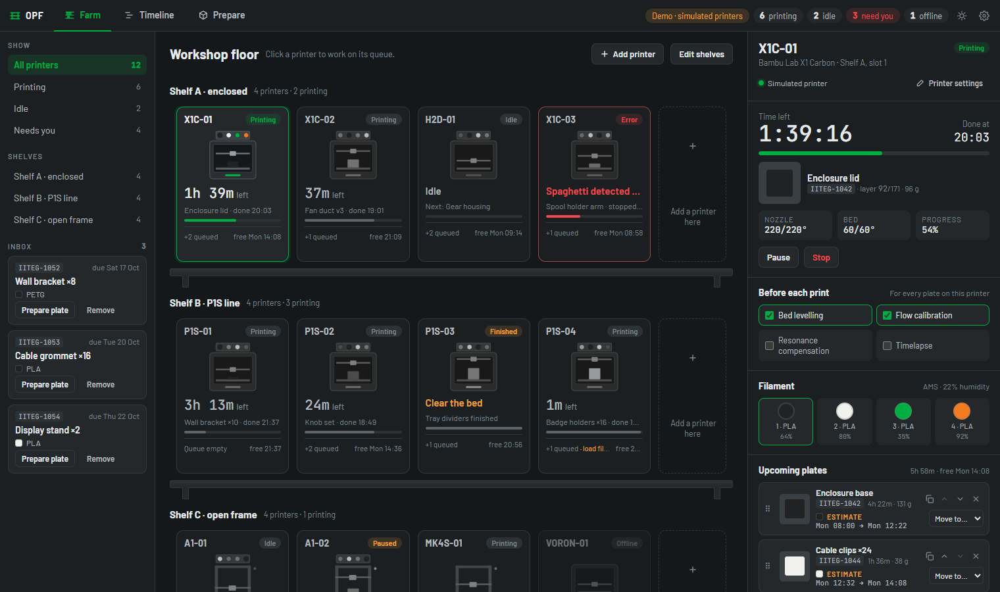

# OPF: Open Print Farm

Run a whole farm of 3D printers from one program. Every printer sits on a shelf the way it stands in
your workshop, with its time left, what is loaded, and a queue of plates behind it. When a print is
done it waits for someone to clear the bed, then the next plate starts. The slicer is built in:
OrcaSlicer's Prepare and Preview, with Farm and Timeline tabs, and Send to farm.

Free and open source (AGPL-3.0). Your printers on your own network, no account, no cloud.

**Download for Windows: [opf.iiteg.com](https://opf.iiteg.com/)**, or the installer on the
[latest release](https://github.com/Artis-98/opf/releases/latest). One installer puts in everything.



## What it does

- **The farm.** Printers on shelves, a queue for each: reorder, move between printers, duplicate, edit
  a queued plate in the slicer and send it back into its place. Bed is clear, start next.
- **The timeline.** The next 48 hours of every printer, with your working hours: prints run overnight,
  the next plate waits for someone to be in.
- **The slicer.** OrcaSlicer with two more tabs. Send one plate, or all plates at once: OPF slices them
  and puts each on the printer that is free first. Sync fills the filament list with what is loaded in
  the printer.
- **Printers.** Bambu Lab (A1, A1 mini in daily use; P1 and X1 on the same protocol) and Anycubic
  Kobra 3, 3 Max and S1, in LAN mode. Add a printer finds them on your network.
- **Before each print.** Bed levelling, flow calibration, resonance compensation and timelapse, per
  printer.
- **By the clock.** A small OPF in the tray watches the farm, tells you when a print finishes, and starts
  with Windows.


## This repository

| Folder | What is in it |
|---|---|
| `src/`, `resources/`, … | OPF Slicer: a fork of [OrcaSlicer](https://github.com/OrcaSlicer/OrcaSlicer). What OPF changes is listed in [`OPF.md`](OPF.md) and marked `// OPF:` in the code. |
| `farm/` | The farm: an Electron app (TypeScript, React) that talks to the printers, keeps the queues and serves the farm page the slicer shows. See [`farm/README.md`](farm/README.md). |
| `site/` | The website, [opf.iiteg.com](https://opf.iiteg.com/). |
| `tools/opf/` | The small server script behind the site's Coming next list. |

## Building

The farm, on its own (Node.js 22 or newer):

```bash
cd farm
npm install
npm run dev      # the farm window, with live reload
npm test
npm run demo     # in a browser, with simulated printers
```

The slicer builds like OrcaSlicer; on Windows `build_win.bat`, see
[OrcaSlicer's build guide](https://github.com/OrcaSlicer/OrcaSlicer/wiki). The Windows installer is built
by the **OPF Windows build** workflow on every change to `main`: it packs the farm, builds the slicer and
attaches the installer and a portable folder to the run.

Updates from OrcaSlicer are merged in:

```bash
git remote add upstream https://github.com/OrcaSlicer/OrcaSlicer
git fetch upstream main
git merge upstream/main
```

## Licence and credits

OPF is free software under the GNU Affero General Public License 3.0, copyright SIA IITEG. The slicer is
OrcaSlicer's work, which grew from Bambu Studio, PrusaSlicer and Slic3r, all under the same licence; their
credits stay in the About box. OrcaSlicer's own readme is [`README.orcaslicer.md`](README.orcaslicer.md).
OPF is not affiliated with Bambu Lab, Anycubic or OrcaSlicer. Licences of everything OPF is built on:
[opf.iiteg.com/licences.html](https://opf.iiteg.com/licences.html).

Problems and ideas: [issues](https://github.com/Artis-98/opf/issues).
