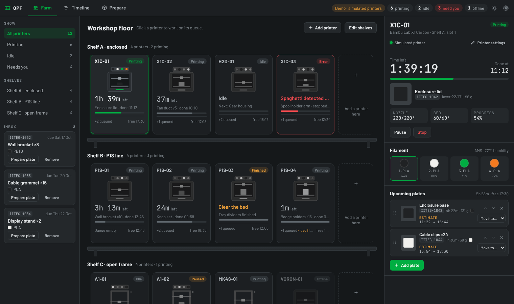
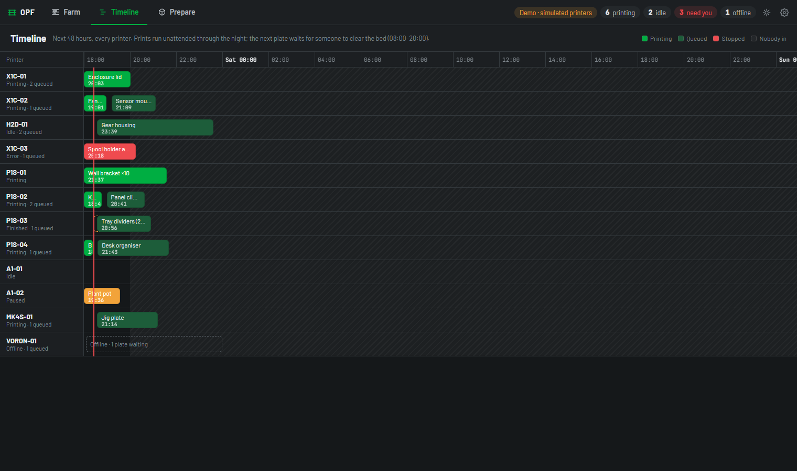
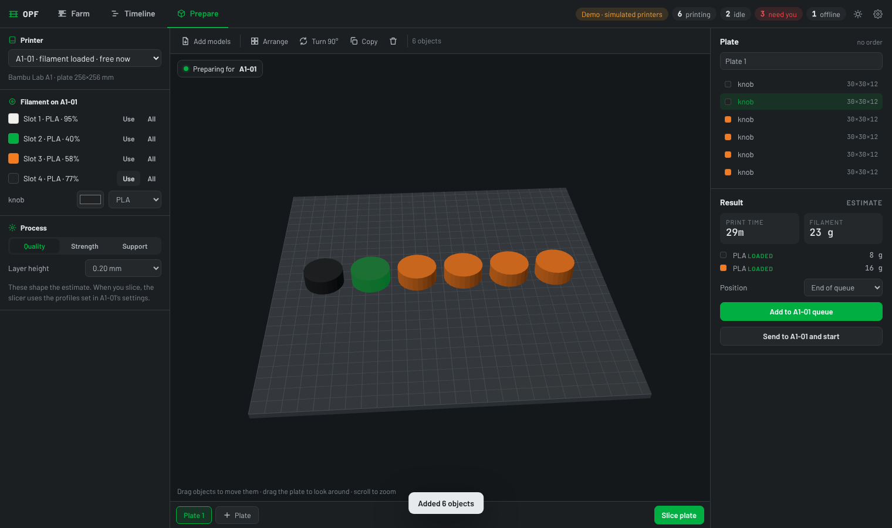

# OPF — Open Print Farm

A desktop app for running a 3D printer farm the way it stands in your
workshop. Every printer sits on a shelf, grey until you pick it. Pick one and
it lights up: what it is printing, what is loaded in its AMS, and the plates
lined up behind it, which you can reorder, move to another printer or add to.
Plates are laid out in a Bambu Studio–style Prepare screen and sliced by the
real Bambu Studio or OrcaSlicer.

Free and open source (AGPL-3.0). No cloud, no account.



## What it does

**Farm**
- Shelves of printers, laid out like your real shelves. Drag printers between
  slots, rename shelves, add slots and shelves.
- Every printer at a glance: time left, idle, finished ("clear the bed"),
  paused, error, offline. Errors stay red even when the printer is not picked.
- Pick a printer to see it live: time left, layer, temperatures, the AMS slots
  with their real colours, material, remaining filament and humidity.
- A queue on every printer: drag plates to reorder, move a plate to another
  printer, remove it. Each plate shows when it starts and finishes.
- A warning when a queued plate needs a colour or material that is not loaded
  on that printer.
- "Bed is clear, start next": a finished plate waits for a person, then the
  next one is sent.

**Timeline**
- The next 48 hours of every printer on one screen.
- Working hours: prints run unattended, but the next plate only starts when
  someone is in to clear the bed. Times outside working hours are shaded and
  plates wait for the morning. Same rules as iiteg-admin-hub's scheduler.



**Prepare**
- Drop STL, 3MF or OBJ files on a 3D plate sized for the chosen printer.
- Arrange, turn, copy, drag objects around the plate.
- Assign each object a colour straight from the printer's AMS slots.
- The printer list says which printers have the filament loaded and when each
  is free.
- An estimate of time and grams straight away; Slice runs Bambu Studio or
  OrcaSlicer for the exact numbers and the file the printer needs.
- Add the plate to the end of a printer's queue, next up, or send it and start.



**Work from other systems**
- An inbox of parts waiting to be put on a plate.
- OPF fetches approved parts from a URL you set (such as admin.iiteg.com)
  and reports back when they are queued. Nothing in the workshop has to be
  reachable from the internet.
- A local HTTP API for anything else on the network.

## Status

Version 0.1, first build. Be clear about what has been checked where:

| Part | State |
|---|---|
| Farm, shelves, queues, timeline, Prepare | Working, in the desktop app and the browser demo |
| Scheduling, filament matching, estimates, farm actions, local API | Covered by tests (`npm test`) |
| Bambu status (incl. AMS colours) | Parser tested against messages shaped like real X1C/P1 reports. **Not yet run against a real printer.** |
| Bambu send and start (FTPS + `project_file`) | Written to the documented LAN protocol. **Not yet run against a real printer.** Needs Developer Mode on the printer. |
| Plates sent from OrcaSlicer | Checked against OrcaSlicer 2.4.2: its OctoPrint upload format, and a plate it sliced read back into a queue (time, grams, colours) |
| Slicing with Bambu Studio / OrcaSlicer from OPF's Prepare | Command line checked with OrcaSlicer 2.4.2 and its built-in A1 presets |
| Klipper / Moonraker, PrusaLink, OctoPrint | Listed, not connected yet: they show as offline and keep their queue |

The first job is to point it at a real Bambu printer and fix whatever the
printer disagrees with.

## Everyday use on Windows

1. Once: in the `opf` folder, double-click **OPF.bat**. It puts an **OPF**
   icon on your desktop and opens OPF.
2. From then on, open OPF from the desktop icon. Each time, it fetches the
   newest version from GitHub first (a few seconds), so new features arrive
   without any commands.
3. While OPF is open, an **Update ready · Restart** button appears in the top
   bar when there is something new. After the restart, **What's new** lists
   the changes.

macOS and Linux: run `./OPF.sh` the same way.

To try things without printing, open **Settings → Test printers** and add a
simulated A1 and A1 mini. They sit on their own shelf, behave like real
printers, and can run up to 60 times faster.

## Running it

Needs Node.js 22 or newer.

```bash
npm install
npm run dev          # the desktop app, with live reload
```

On Windows, if PowerShell says *running scripts is disabled on this system*,
type `npm.cmd` instead of `npm`, or allow local scripts once with
`Set-ExecutionPolicy -Scope CurrentUser RemoteSigned`.

`npm run dev` downloads Electron itself the first time if npm skipped that
step (newer npm versions hold back install scripts until approved, which
otherwise ends in "Error: Electron uninstall").

Try it in a browser with simulated printers, no Electron needed:

```bash
npm run demo         # http://localhost:5199
```

Build an installer:

```bash
npm run dist:win     # release/OPF Setup x.y.z.exe
npm run dist:mac
npm run dist:linux
```

Checks:

```bash
npm test
npm run typecheck
```

## Connecting a Bambu Lab printer

1. On the printer: Settings → Network. Note the **IP address** and the
   **access code**. Turn on **LAN mode**, and **Developer Mode** if you want
   OPF to start and stop prints (status works without it).
2. Settings → Device: note the **serial number**.
3. In OPF: Add printer → Bambu Lab, local network → fill in the three.

The printer's own certificate cannot be checked against its IP address, so OPF
accepts it for this local connection only.

## Slicing profiles

OPF slices with your own slicer and your own settings. For each printer:

1. In Bambu Studio (or OrcaSlicer) pick that printer, your process and
   filament, then **File → Export → Export Configs**.
2. In OPF: the printer's settings → Slicing profiles → choose the exported
   printer, process and filament `.json` files.

OPF finds Bambu Studio or OrcaSlicer in their usual install folders, or set the
path in Settings.

## OPF Slicer

[OPF Slicer](https://github.com/Artis-98/opf-slicer) is OrcaSlicer with four tabs:
**Farm**, **Timeline**, **Prepare** and **Preview**. Farm and Timeline are this
farm; Prepare and Preview are OrcaSlicer's own.

- Click a printer in the Farm tab, slice in Prepare, and **Send to** that printer
  from Preview. The plate goes into its queue together with its project.
- **Edit** on a plate in a queue opens its project in Prepare. Sending it again
  replaces the plate in its place in the queue.
- OPF Slicer starts OPF without a window when it is not running (a tray icon
  shows it is there). OPF writes where its launcher is to `launcher.json` in its
  settings folder for that.

## Sending plates from OrcaSlicer

OPF answers like an OctoPrint printer, so OrcaSlicer (and Bambu Studio with a
third-party print host, and PrusaSlicer) can send sliced plates straight into
OPF's queues, and show the farm in its Device tab.

1. In OPF, open a printer's settings and copy the address under **Send plates
   from OrcaSlicer**, for example `http://127.0.0.1:7878/octo/p-1ikwceq6`.
2. In OrcaSlicer, open that printer's connection settings. For a Bambu Lab
   printer, first tick **Use 3rd-party print host** in the printer settings.
   Host type **OctoPrint**, paste the address, **Test**.
3. Slice and press **Send** (or **Upload and print**). The plate lands in that
   printer's queue with OrcaSlicer's own time, weight, colours and picture.

`http://127.0.0.1:7878` on its own (in **Settings → Send plates from
OrcaSlicer**) puts each plate on whichever printer can start it soonest with its
filament loaded.

## Running OPF without a window

For an always-on PC or a Raspberry Pi:

```bash
npm install
npm run server            # this computer only
node out/main/server.js --lan   # also phones and other PCs (they need the token)
```

The farm is kept in `~/.opf`. Open `http://127.0.0.1:7878/` in a browser.

## Sending work to OPF

### OPF fetches it (recommended for a website such as admin.iiteg.com)

Settings → Receive work → the URL and a token. Every minute OPF sends

```
GET <url>
Authorization: Bearer <token>
```

and expects

```json
{
  "items": [
    {
      "id": "1052",
      "ref": "IITEG-1052",
      "name": "Wall bracket",
      "qty": 8,
      "material": "PETG",
      "color": "#202224",
      "due": "2026-10-17",
      "file_url": "https://example.com/files/bracket.stl",
      "notes": "Matte side out"
    }
  ]
}
```

Only `id` and `name` are required. Each `id` is taken once, so a part that has
been handled or removed in OPF is not fetched again. When a plate made from it
is queued, OPF reports back:

```
POST <url>/status
Authorization: Bearer <token>

{ "ref": "IITEG-1052", "status": "queued", "printer": "P1S-02",
  "start": "2026-10-15T08:10:00.000Z", "end": "2026-10-15T12:20:00.000Z" }
```

### Local API

On by default at `http://127.0.0.1:7878`, token in Settings.

| | |
|---|---|
| `GET /api/v1/printers` | Every printer: status, progress, time left, loaded filament, queue with start and end times, when it is free |
| `GET /api/v1/printers/:id` | One printer |
| `GET /api/v1/inbox` | Parts waiting |
| `POST /api/v1/inbox` | Send parts: `{ "name": "…", "qty": 2, "ref": "…", "material": "PLA", "color": "#00AE42", "due": "2026-10-20", "file_url": "…" }` |
| `DELETE /api/v1/inbox/:id` | Remove one |

```bash
curl -H "Authorization: Bearer $TOKEN" http://127.0.0.1:7878/api/v1/printers
```

## How it is built

Electron, React and TypeScript, with three.js for the plate.

```
src/core/       the farm itself, no Electron: model, scheduler, filament
                matching, estimates, Bambu report parsing, simulated printers
src/main/       Electron main process: Bambu driver (MQTT + FTPS), slicer
                runner, local API, inbox fetcher, saving farm.json
src/preload/    the bridge the window talks through
src/renderer/   the window: Farm, Timeline, Prepare
```

The window talks to the farm only through `window.opf` (see
`src/preload/api.ts`). In a plain browser the same API is provided by a farm of
simulated printers running in the page, which is how `npm run demo` works.

The farm is one JSON file in the app's data folder (`farm.json`), written
atomically.

A new printer brand is one driver implementing `PrinterDriver` in
`src/core/driver.ts`.

## Next

- Run against real Bambu printers (X1C, P1S, A1, H2D) and fix what they
  disagree with
- Keep the models with queued plates, so a plate queued with an estimate can be
  sliced later
- Klipper / Moonraker, PrusaLink and OctoPrint drivers
- Camera view
- Windows installer on a release page, like DATUM's

## Licence

AGPL-3.0-or-later. See [LICENSE](LICENSE). Bambu Studio and OrcaSlicer are
separate programs under their own licences; OPF runs them, it does not include
them.
